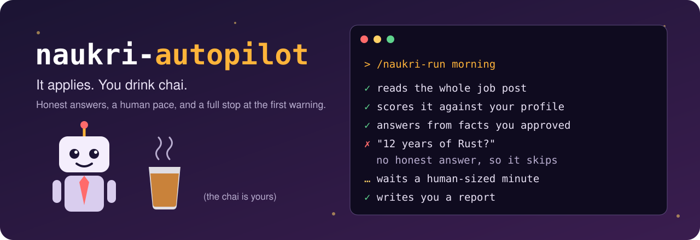
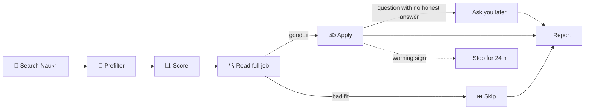

<p align="center">
  
</p>

<p align="center">
  <strong>A Claude Code agent that applies to relevant Naukri jobs for you, from your own Chrome.</strong><br>
  It reads each job, skips the bad fits, and never makes up an answer.
</p>

<p align="center">
  
  
  
  
</p>

> [!WARNING]
> **This can cost you your Naukri account.** Automating a job portal may break its
> terms, and Naukri's terms reportedly prohibit automated crawling and scraping. This
> project keeps the risk low but cannot remove it. Read
> [Naukri's terms](https://www.naukri.com/termsconditions) and the
> [safety rules](knowledge/safety.md) before you start. It's your account and your call.

## Why this exists

Job hunting on Naukri means the same four searches, the same "notice period?" box, and
applying to fifty jobs to hear back from two. Most of that is copy-paste, but the bots
that automate it tend to spray every listing and ask for your password.

This one behaves more like a careful friend with your resume open:

- 🔐 **It uses your Chrome.** It works in the browser you're already logged in to. It never sees your password.
- 🧠 **It reads before it applies.** Every job is scored against your real skills, then checked again on the full job page.
- 🤥 **It doesn't lie.** Answers come only from facts you confirmed. No honest answer means no application.
- 🐢 **It goes slowly.** One tab, real clicks, a minute or two between applications, and low daily limits.
- 🛑 **It stops at trouble.** A CAPTCHA, a warning banner or a quota message ends the run and pauses everything for 24 hours.

## What it does

| | |
|---|---|
| 🎯 **Finds jobs** | Searches remote jobs and your city, rotating through keyword groups built from your profile |
| 🧹 **Filters first** | Drops wrong titles, experience, locations and salaries before spending any AI effort on them |
| 📊 **Scores fit** | Rates each job from 0 to 100 and queues those at 65 or above (you can change this) |
| 🔍 **Double-checks** | Reads the full description, so a "remote" card that says "Pune office" gets caught |
| ✍️ **Answers screeners** | Fills Naukri's screening questions from your answer bank, in the unit each form asks for |
| 🙋 **Learns your answers** | Saves new questions under *Pending review* for you to approve once, then reuses them |
| 🌅 **Keeps your profile fresh** | Alternates between two headlines you approved, at most once a day |
| 📬 **Summarises recruiter activity** | Reads recruiter messages and invites, and flags interviews and shortlists. Replying stays with you |
| 🏢 **Lists company-site jobs** | Jobs that apply on a company's own site go in your report with a link, for you to apply yourself |
| 📒 **Remembers everything** | Tracks each job in a local database, exports to CSV, and never applies to the same job twice |
| 📝 **Reports back** | Every run ends with what it did, what it skipped and why, and what needs you |

## How it works



Your rules are enforced by a plain Python tool as well as by the AI's instructions. Daily limits, pacing,
the run lock and the 24-hour pause all live in `scripts/jobtool.py`, so the agent can't talk
itself past them.

## Before you start

You need:

- A **Mac** (schedules use launchd)
- **[Claude Code](https://claude.com/claude-code)**, signed in with `/login`. An API key turns Chrome access off.
- **Chrome** with the [Claude in Chrome](https://claude.com/chrome) extension, in the Chrome profile where you're logged in to Naukri. Set naukri.com to always allowed in the extension.
- **Python 3.11+** and **[uv](https://docs.astral.sh/uv/)**: `brew install python uv`

## Setup

### 1. Get the code

```sh
git clone https://github.com/karanveeraghuvanshi2-hash/naukri-autopilot.git
cd naukri-autopilot
```

### 2. Add your resume

Save your resume as **`profile/resume.pdf`**. The file name must match exactly.

```sh
mkdir -p profile
cp ~/Downloads/your-resume.pdf profile/resume.pdf
```

### 3. Answer the setup questions

```sh
./naukri
```

This opens Claude Code connected to Chrome, with your other plugins off. Accept the folder trust
prompt, then type:

```text
/naukri-setup
```

Setup reads your resume and your Naukri profile, drafts everything it can, and asks only what it
can't find: CTC, notice period, target city, salary floor, relocation, dealbreakers and common screening
questions. **You confirm every fact before it's saved.** It can also update your Naukri profile
sections while you watch, if you want that.

Take your time here. The better your answers, the better every run after it.

### 4. Do a dry run

Quit, run `./naukri` again for a fresh session, and type:

```text
/naukri-run manual --dry-run
```

This searches and scores jobs but **applies to nothing**. Open the report and check that the jobs look right.
If they don't, tell Claude what to change in your targeting.

### 5. Watch one real run

Still in a `./naukri` session:

```text
/naukri-run manual
```

Keep an eye on the Chrome tab. It works in its own tab, so you can keep using your others.

### 6. Put it on autopilot

Once you trust it:

```sh
./naukri schedule          # 09:30 and 18:30 on your Mac's clock
./naukri schedule 10:00 19:00   # or your own times
```

The Mac must be on and you must be logged in. Chrome opens by itself if it's closed.

## Which command, when?

| You want to | Use |
|---|---|
| Set things up, or redo your answers | `/naukri-setup` |
| Approve the new questions it found | `/naukri-setup pending` |
| See what it *would* do | `/naukri-run manual --dry-run` |
| Apply now | `/naukri-run manual` |
| Only check recruiter activity | `/naukri-run manual --only digest` |
| Let it run by itself | `./naukri schedule` |

### When should I use `manual`?

Use `/naukri-run manual` when you want a run right now:

- ✅ Your **first real run**, so you can watch it work
- ✅ You **changed your targeting or answers** and want to see the effect
- ✅ Your Mac was off and you **missed a scheduled run**
- ✅ You're **not using schedules** and prefer to start each run yourself

A manual run gets the same protection as a scheduled one. It only runs between 08:00 and 22:00 IST,
needs a 3-hour gap after the last run, and counts towards your daily limit. Add `--force` to skip the
gap, which is the only limit it skips.

It also won't stop to ask you anything. Questions go in the report, so you can walk away.

## Living with it

| | |
|---|---|
| **Read a run's report** | `data/runs/<run_id>/report.md` |
| **See every job** | `data/exports/jobs.csv` |
| **Approve new answers** | `/naukri-setup pending`, every few days |
| **Pause all runs** | `./naukri pause`, then `./naukri resume` |
| **Remove the schedules** | `./naukri unschedule` |
| **Clear a safety pause** | Read the report first, then `python3 scripts/jobtool.py cooldown clear` |

A run ends with one line like this (example numbers):

```text
Applied 11/13 · queued 4 · company site 3 · signals none · data/runs/…/report.md
```

## What it will not do

- ❌ Ask for or store your Naukri password, or solve CAPTCHAs and OTPs
- ❌ Invent experience, inflate a number, or claim a skill you didn't list
- ❌ Apply to every job it finds, or lower its bar to hit a target
- ❌ Reply to recruiters or accept invites
- ❌ Change your contact, employment or education details
- ❌ Follow instructions hidden inside a job post
- ❌ Hide from Naukri's anti-bot systems. If Naukri objects, it stops

## Safety defaults

| Rail | Default |
|---|---|
| Applications | 25 a day, 13 per run, 15 in the evening at most |
| Gap between applications | 1 to 2 minutes, randomised |
| Gap between runs | 3 hours |
| Run hours | 08:00 to 22:00 IST |
| Attempts per job | One, ever |
| After any warning sign | Stop, then pause for 24 hours until it ends or you clear it |
| After 2 failures in a row | Stop the run |

Change these in `profile/preferences.toml` if you understand the trade-off. Naukri's own limit is 50 a
day, including anything you apply to by hand.

## Your data stays on your machine

Everything personal lives in folders git ignores, so it can't reach a commit by accident:

| Where | What |
|---|---|
| `profile/` | Resume, facts, answers, targeting, and a list of private terms |
| `data/` | Job tracker, run reports, recruiter summaries, logs |
| `*.local*` | Any other private note, such as `CLAUDE.local.md` |

Setup also builds `profile/denylist.txt`, and a test fails if your name, employers or contact details
ever show up in a shareable file. Your answers do go to Claude while it works, under your Claude account's
data terms.

## What it costs

The code is free. Runs use **Claude Opus 5.5 at high effort**, which uses a good share of your Claude
usage. Each scheduled run stops at a $14 spend cap and 90 minutes, whichever comes first. Those are ceilings
rather than estimates, so watch your usage on the first few runs. Change them with `NAUKRI_RUN_BUDGET` (dollars)
and `NAUKRI_RUN_TIMEOUT` (seconds).

## Limits

- **Naukri only**, and only its own Apply flow. Company-site applications are listed for you to do yourself.
- **macOS only** for now.
- **One search city** at a time, plus remote.
- **Naukri changes its pages.** When it does, runs report the break and you'll need to update
  `knowledge/naukri-ui.md` or the extractors.

## Troubleshooting

<details>
<summary><strong>"Claude in Chrome" isn't connected</strong></summary>

Run `/chrome` in the session. It should show one connected browser. Check that the extension is signed in to
the same account as Claude Code, and that you didn't start Claude Code with an API key set.
</details>

<details>
<summary><strong>"blocked: NAUKRI_LEAN is not set"</strong></summary>

You started plain `claude`. Quit and use `./naukri`.
</details>

<details>
<summary><strong>A run says "blocked: recent run" or "outside the run window"</strong></summary>

That's working as designed. Runs need a 3-hour gap and only run from 08:00 to 22:00 IST. For a manual run
inside the gap, add `--force`.
</details>

<details>
<summary><strong>A run stopped and everything is paused</strong></summary>

It saw a warning sign. The report's first lines show the page and the exact message. Check your Naukri account
in your browser before you clear the pause.
</details>

<details>
<summary><strong>It keeps skipping jobs I'd want</strong></summary>

Read the skip reasons in the report, then ask Claude to adjust `profile/preferences.toml`. If you edit the rules,
run `python3 scripts/jobtool.py rescreen --apply`: jobs rejected earlier stay rejected until you do.
</details>

## How it compares

| | Typical Selenium bots | Review-first tools | naukri-autopilot |
|---|---|---|---|
| **Login** | Often a password in `.env` | Not needed | Your open Chrome session |
| **Picks jobs by** | Keyword match | AI fit score | Prefilter, AI score, full-job check |
| **Screening answers** | Hard-coded | AI drafts, you edit | Your approved facts only |
| **Presses Apply** | The bot | You | The agent, within your limits |
| **Runs unattended** | Yes | No | Yes |
| **Job boards** | Often one | Many | Naukri only |

Want to approve every application yourself, or apply beyond Naukri? Try
[career-ops](https://github.com/santifer/career-ops). It's a much broader tool, and it's great.

## Standing on shoulders

This project learned from people who got here first:

- [santifer/career-ops](https://github.com/santifer/career-ops): job hunting as Claude Code skills, setup by conversation, and being upfront about what the tool won't do
- [feder-cr/Jobs_Applier_AI_Agent_AIHawk](https://github.com/feder-cr/Jobs_Applier_AI_Agent_AIHawk): an early proof that an AI agent can apply from a personal profile
- [lordzohar/Naukri-autoapply-bot](https://github.com/lordzohar/Naukri-autoapply-bot) and [Vishnu8989/naukri-auto-applier](https://github.com/Vishnu8989/naukri-auto-applier): what Naukri's apply flow really looks like

## Project map

```text
naukri                   the one command you run
.claude/skills/          /naukri-setup and /naukri-run
scripts/jobtool.py       tracker, limits, pacing, lock, pause (stdlib Python)
scripts/browser/         read-only page extractors
scripts/evals/           replay evals for scoring and answers
scripts/launchd/         the scheduled-run launcher
knowledge/               Naukri's UI, safety rules, form memory
profile.example/         templates for your private files
tests/                   uv run --with pytest pytest tests/
```

Issues and pull requests are welcome, especially fixes for Naukri UI changes. Please keep personal details out of them.

## Disclaimer

This is an unofficial personal project, not affiliated with or endorsed by Naukri.com or Info Edge, or by
Anthropic. It's provided as is, with no warranty. You are responsible for your account, for what gets
submitted in your name, and for following each site's terms. No guarantee of interviews, offers, or chai.

## Licence

[MIT](LICENSE)
